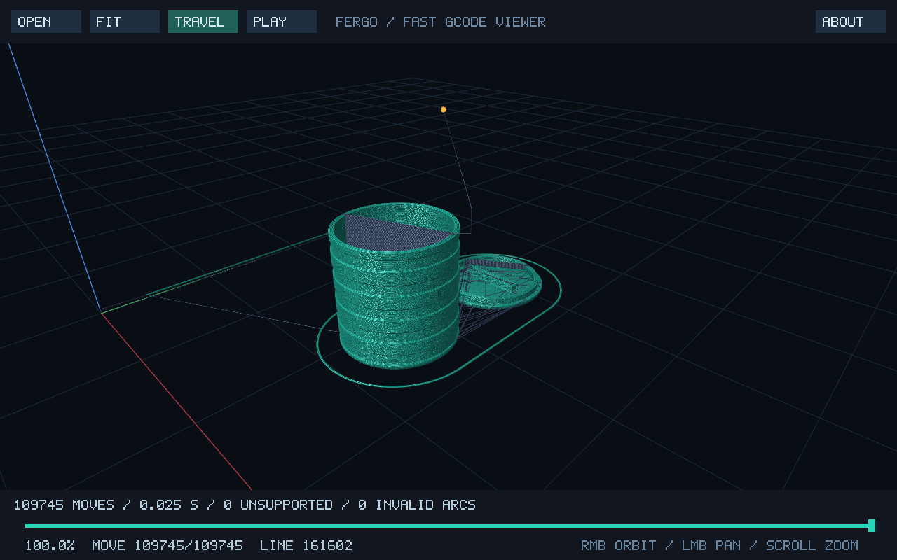

# Fergo Fast GCode Viewer

Version **1.0.0**. Developed by Fergo - 2026.

A native C++17 GCode viewer using SDL3 and OpenGL, focused on fast startup and
interactive navigation. No Python, browser, .NET, or interpreted runtime.



## Run

Open `dist/fergo-gcode-viewer.exe`. Keep `SDL3.dll` in the same directory.
Drop a GCode file onto the window or click **OPEN**. Unicode paths are supported.
The title shows the application name and loaded filename; diagnostics stay in the footer.

```powershell
./dist/fergo-gcode-viewer.exe examples/demo.gcode
# Optional unsupported-command log:
./dist/fergo-gcode-viewer.exe --log examples/demo.gcode
```

| Control | Action |
| --- | --- |
| Mouse wheel | Zoom |
| Right button + drag | Orbit |
| Left button + drag | Pan |
| Bottom slider | Move forward/backward through geometric moves |
| FIT / F / Home | Fit model to view |
| TRAVEL / T | Show/hide moves without extrusion |
| PLAY / Space | Play/pause |
| Left/right arrows | Step backward/forward one move |
| Shift + arrows | Step backward/forward 100 moves |
| Hold left/right arrow | Repeat steps (Shift still selects 100 moves per step) |
| Speed slider (during PLAY) | Adjust playback speed from 0.1x to 10x |
| O | Open file |
| ABOUT / F1 | Show version, author, and technologies |
| COLORS | Customize scene colors with live preview |
| Click / Esc / Enter in About | Close About |
| Esc | Exit |

Green indicates positive extrusion; muted blue indicates travel. The yellow
marker shows the current nozzle position. The slider follows geometric moves;
comments, heating commands, and stationary extrusion do not consume steps.
The footer identifies the original source line. Playback takes approximately
30 seconds at 1x for larger files and does not simulate actual print time.
During playback, a SPEED slider appears above the footer. Adjust it live from
0.1x to 10x; the center is 1x. The selected speed is retained when pausing or
opening another file. Holding an arrow repeats steps using the keyboard's
configured repeat delay/rate and pauses playback.

## Colors

Click **COLORS**, select an item, and drag its R/G/B sliders. Background, grid,
travel, extrusion line, nozzle marker, and X/Y/Z axes can be customized.
Changes apply immediately, without rebuilding or reuploading the GCode geometry.
Opening the panel pauses playback. Release a slider to save automatically.
**SAVE** saves explicitly, **RELOAD** reads manual file edits, **DEFAULTS** restores
and saves the original palette, and **CLOSE** / Esc / Enter closes the panel.

Preferences live in `colors.txt` **next to the executable**, independently of the
current working directory. If the file is missing, the viewer creates it using
the default colors. The format is deliberately simple:

```text
; Comments start with a semicolon
background = #090D14
grid = #1A2633
travel = #4F658B
line = #28D2B9
nozzle = #FFB840
axis_x = #B33D47
axis_y = #40A66E
axis_z = #4D8CE6
```

Use lowercase names and six-digit RGB hex values. Hex digits can be uppercase
or lowercase; whitespace and trailing semicolon comments are accepted.
Unknown names and invalid values are ignored; omitted colors use defaults.
On save, the viewer rewrites the known entries in this format, so custom comments
are not preserved. Write failures appear in the panel; the live preview still works.
Extrusion and travel colors are base colors: lighting and depth attenuation remain active.
The interface uses its own fixed colors to keep the controls readable.
Build scripts preserve an existing `colors.txt` rather than overwriting preferences.

## Performance and rendering

- The window opens before file parsing starts.
- Sequential parsing runs on a worker thread; opening another file cancels it.
- Geometry uploads once into a GPU VBO; the CPU vertex copy is then released.
- Slider changes only the vertex count passed to `glDrawArrays`.
- GPU shaders expand segments into cylindrical-looking strips with diffuse
  lighting, specular highlights, surface depth, and distance attenuation.
- Nominal extrusion thickness is 0.22 mm, with a minimum pixel width for visibility;
  this is a display setting, not the slicer's actual extrusion width.
- MSAA 4x when available. Bitmap text uses integer physical pixels for consistent strokes.
- The application redraws only when needed and waits for events while idle.
- Custom UI and font: no additional UI, font, or math libraries.
- Requires OpenGL 3.3 **compatibility**. The Windows executable opens without a console.

An earlier local Release parser benchmark processed 22,500,015 bytes and 999,999
moves in 0.215 seconds. This includes file reading, possibly with a warm OS cache,
excludes GPU upload, and is not a guarantee for other systems or files.

## Supported GCode

`G0/G1`, modal moves, `G2/G3` with I/J/K or signed R, full IJK circles,
helical arcs, `G17/G18/G19`, `G20/G21`, `G90/G91`, `G90.1/G91.1`, `G92`,
`M82/M83`, and extruder selection `T0..T255`. Coordinates and extrusion use
independent absolute/relative modes. Semicolon and parenthesized comments,
line numbers, and checksum suffix delimiters are recognized. Checksums are not validated.

Arcs use a nominal 0.05 mm segmentation tolerance and a limit of 100,000 segments
per arc. Invalid arcs become straight lines and increment INVALID ARCS.
Unknown G commands block movement on their line and increment UNSUPPORTED.
Unknown M commands are counted but do not change printer settings.
Known temperature/fan commands are ignored. CNC files without E appear as travel;
keep TRAVEL enabled.

### Slicer configuration commands

- `G28`: home all or selected X/Y/Z axes, including bare axes (`G28 X Y`).
  Without a machine profile, home is assumed to be zero and the selected axes'
  G92 offsets are cleared. No artificial homing path is drawn. `G28 O` skips
  homing when the selected axes are already homed.
- `M73 P/R`: retain slicer progress and remaining minutes, without moving the slider.
- `M201`, `M203`, `M204`, `M205`: retain acceleration/feedrate limits,
  print/retract/travel acceleration, jerk, and related parameters.
- `M220`: retain speed percentage, including B/R backup/restore.
- `M221 S/T`: track flow per extruder. Zero flow makes the move travel;
  positive flow preserves extrusion classification without changing logical E
  coordinates or the fixed visual thickness.
- `M900 K/T`: retain Linear Advance per extruder.

Final settings are available in `Model::settings`. Acceleration, jerk, pressure,
and real print timing are not simulated. Macros, tool offsets, G54-G59, bed
compensation, G5, and manufacturer-specific commands are not physically simulated.
Zero home is an approximation for machines with different home positions.
Command semantics follow the [Marlin GCode documentation](https://marlinfw.org/meta/gcode/).

## Optional unsupported-command log

Logging is **disabled by default**. Launch with `--log` to enable it for all files
opened during that session, including dropped files:

```powershell
./dist/fergo-gcode-viewer.exe --log
```

Opening `part.gcode` then writes `part.gcode.unsupported.log` alongside it, in UTF-8.
Each occurrence includes the physical source line number, command, and original text:

```text
12 | G59.1 | G59.1 ; workspace
45 | M999 | M999
```

The file is overwritten on each load when logging is enabled. Supported commands
are excluded. A COMPLETE footer confirms the scan finished; cancellation may leave
a partial file without this footer. Even zero occurrences produce a header and total.
Writing failures show a warning while visualization remains available.
Without `--log`, existing log files are left untouched.

## Windows build

The portable setup uses GCC from `.tools/w64devkit` and SDL3 3.4.18 from
`vendor/SDL3-3.4.18`, without global installation:

```powershell
./build.ps1
./build.ps1 -Debug
./build.ps1 -OutputDirectory dist/custom
```

Alternatively, use `build.bat` (also supports double-click). It prefers PowerShell 7
and falls back to Windows PowerShell, forwarding the same arguments:

```bat
build.bat
build.bat -Debug
build.bat -OutputDirectory dist\custom
```

Close the viewer before rebuilding into its directory, or choose another output
directory. The scripts compile the application and run parser tests. Release builds
are stripped; Debug builds preserve symbols and disable optimization.
The toolchain and development package are not required to run the viewer.

`docs/icon.ico` is embedded in the Windows executable by
`src/app.rc`. `src/app_icon.h` contains the same decoded image for the SDL window
icon on all platforms; regenerate it if you replace the original icon.
Application name/version are defined in `src/app_info.h`.

## Linux build

Install Bash, CMake >= 3.20, a recent C++17 compiler (GCC 11+ recommended),
SDL3 and OpenGL development packages, and Make or Ninja. SDL2 cannot replace SDL3;
the SDL3 package must provide `SDL3Config.cmake`. Nothing is downloaded or installed
by the script, and the Windows toolchain/dependencies are not used.

```bash
bash build.sh
./build/linux/fergo-gcode-viewer examples/demo.gcode
bash build.sh --debug
bash build.sh -DCMAKE_PREFIX_PATH=/opt/SDL3
bash build.sh --build-dir build/linux-debug --debug
```

The script configures CMake, builds in parallel, and runs parser tests.
Running the viewer requires a graphical session and OpenGL 3.3 compatibility.
Windows x64 has been built and tested; Linux compilation/runtime remain unverified.
macOS requires adaptation to an OpenGL core renderer.

For manual CMake builds:

`CMakeLists.txt` describes the application's source files, required libraries,
Windows resources, and test targets. CMake uses it to generate build files for
tools such as Make, Ninja, or Visual Studio. `build.sh` uses this configuration;
`build.ps1` and `build.bat` invoke the portable Windows compiler directly.

```text
cmake -S . -B build -DCMAKE_BUILD_TYPE=Release -DCMAKE_PREFIX_PATH=/path/to/SDL3
cmake --build build --config Release
ctest --test-dir build -C Release --output-on-failure
```

## Code formatting

The project's `.clang-format` keeps opening braces on the same line, uses four
spaces, inserts blank lines between definitions, and expands short functions
instead of keeping their bodies on one line. `ColumnLimit: 0` disables a fixed
line-length limit. Existing intentional line breaks can still be preserved.
VS Code's **Format Document** reads this file through the workspace settings.
The generated icon pixel array is not reformatted.

## Verification

```powershell
./dist/parser-tests.exe
./dist/colors-tests.exe
./dist/parser-tests.exe --benchmark
./dist/fergo-gcode-viewer.exe examples/demo.gcode --smoke
./dist/fergo-gcode-viewer.exe examples/demo.gcode --selftest
```

The benchmark creates and removes a synthetic million-line file. The selftest
injects SDL events for zoom, orbit, pan, slider, travel filtering, About, and file
drop/reload, repeated arrow steps, and playback speed dragging. It checks the
resulting state and saves screenshots in `dist`. Color settings tests verify
loading, malformed values, saving/reloading, and preservation after a failed write.
The UI selftest also checks the COLORS panel, auto-save, reload, and defaults,
using a separate `selftest-colors.txt` so it does not alter user preferences.
This does not replace manual Explorer drag-and-drop or file-dialog testing.
Rendering was verified locally on NVIDIA OpenGL 4.6.

SDL3: <https://libsdl.org/> - zlib license included in `dist/SDL-LICENSE.txt`.
w64devkit: <https://github.com/skeeto/w64devkit> - build tool only.
